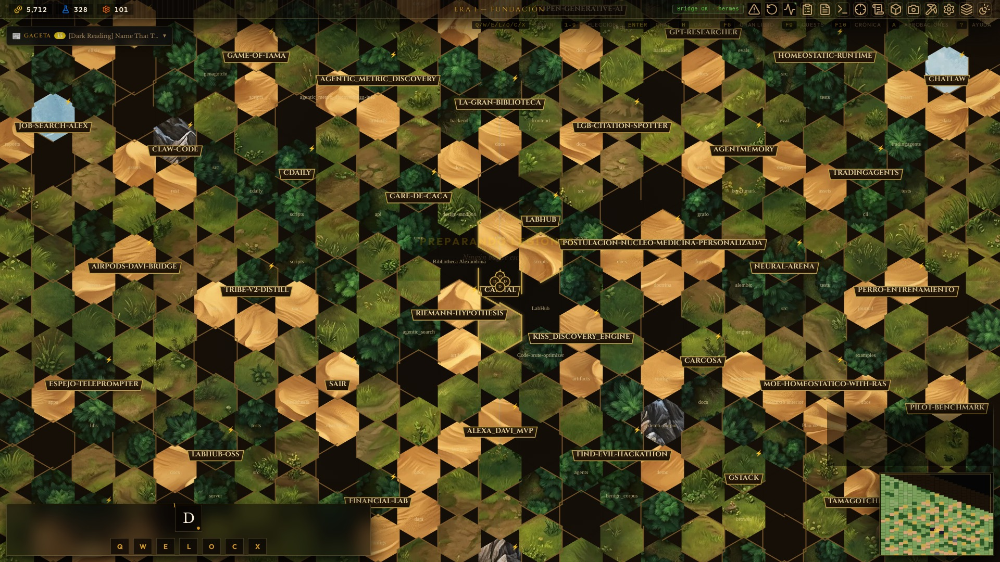
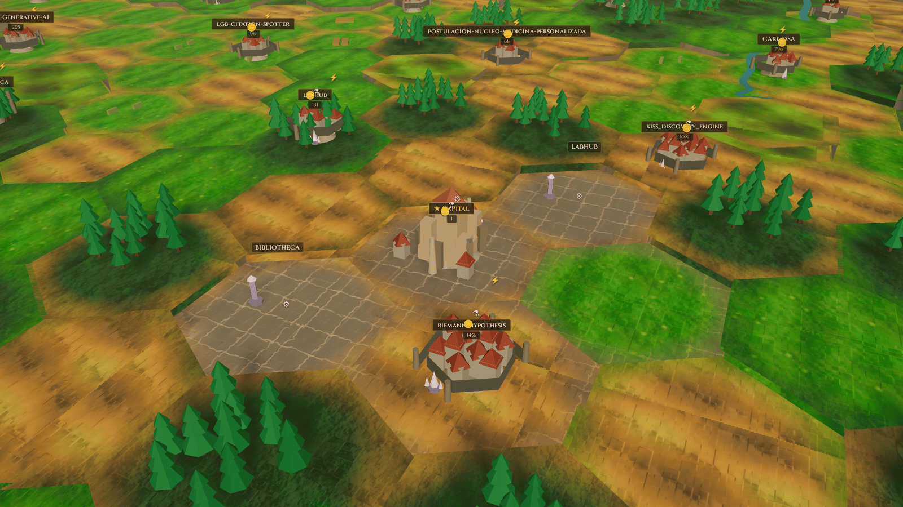
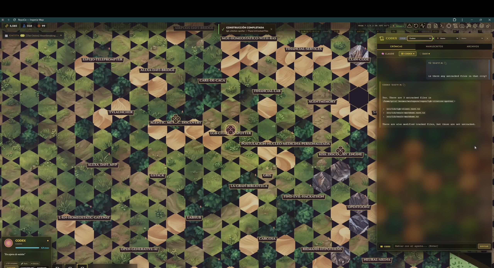
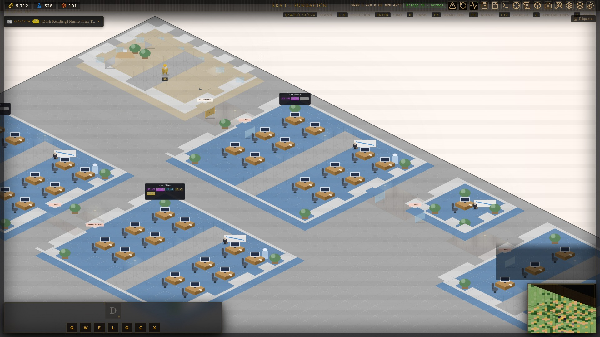
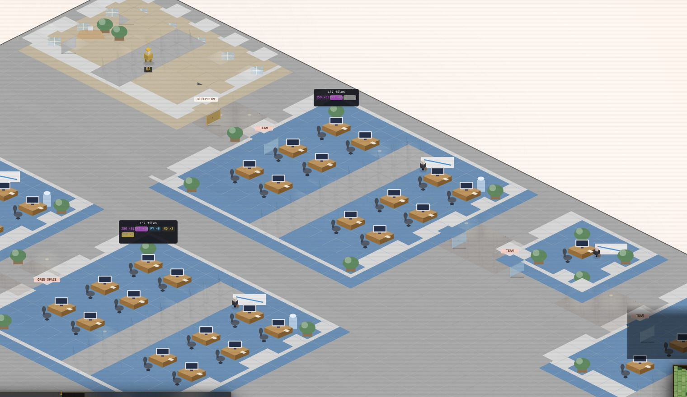

# RepoCiv — Imperial Agent Dashboard

> 🌐 **Languages:** [English](README.en.md) · [Español](README.md)

[](https://opensource.org/licenses/MIT)
[](https://github.com/Grizaceo/repociv/actions)
[](docs/SCOPE.md)

> A hexagonal dashboard inspired by Civilization V that visualizes your repos folder as cities on a map, AI agents as units, and background processes as buildings.

**Stack:** TypeScript + Vite (Canvas 2D + WebGL/Three.js) · Python HTTP bridge · DuckDB/JSONL local ledger
**Compatible with:** [Hermes Agent](https://hermes-agent.nousresearch.com) (Nous Research) — drop-in in any existing setup

**New demo (40 s):** [watch MP4](docs/design/screenshots/repociv-demo-2026-10-05.mp4) · [GIF](docs/design/screenshots/repociv-demo-2026-10-05.gif). The map, local workspace view, and a real Codex query in an example workspace. [Capture details](docs/design/screenshots/repociv-demo-2026-10-05.md).

 | 
--- | ---
*Flat hexagonal map — classic, fast, feature-complete.* | *3D WebGL render (Three.js r175) — faceted low-poly Civ V pass: biomes, dense forests, walled cities, golden hour. Units spawn/despawn, cities grow by tier, fog of war transitions.*


*Click a city on the map, ask your agent what's there — the agent inspects the real repo and answers.*

---

## Local View — RimWorld / isometric 2.5D style

Double-clicking a city on the map opens the **local view**: a RimWorld-style isometric office generated procedurally from the repo's real structure.



Each room maps to a folder in the repo. Units (AI agents) walk between workbenches, manager NPCs stand in front of whiteboards, and doors slide as you pass.



### Local view elements

| Element | What it represents |
|---------|--------------------|
| **Room** | Repo folder — zone-colored by type (`team_cluster`, `focus`, `break`, `infra`, `meeting`) |
| **Workbench** (`×`) | File prioritized by the Priority Matrix — hover shows name and score |
| **Whiteboard** | North wall of each room — click opens a panel with navigable subfolders |
| **Manager NPC** | Stationary figure in front of the whiteboard — represents the room, clickable for info |
| **Unit (agent)** | Animated 2.5D prism — walks workbench to workbench while working |
| **Door** | Divides rooms — slides on enter/exit (parallelogram animation) |
| **Floor lamp** | `focus` zone — ambient light in the interior NW corner |
| **Coffee maker** | `break` zone — interior NE corner |
| **Door plate** | Floating label over each room |

**Local view hotkeys:** `F` debug overlay · arrows / `W/A/S/D` pan · `Esc` return to the macro map. `1` and `4–9` select session slots, not rooms; `2`/`3` switch the 2D/3D renderer.

---

## What is this?

RepoCiv turns your repos folder into an interactive map:

- Each **repo** is a **city** on the hexagonal map
- Each **AI agent** (Claude, Codex, your own LLM) is a **unit** that walks toward workbenches in an isometric 2.5D office
- **Background processes** are buildings inside the city
- The **HTTP + WebSocket bridge** connects the map in real time with your agent runtime

It is single-user by design: a board for coordinating your own agent ecosystem, locally, without cloud.

---

## Quick Start

### Option A — Docker (recommended for trying it out)

```bash
git clone https://github.com/Grizaceo/repociv.git
cd repociv
export MAP_ROOT="$HOME/projects"   # folder whose subdirs become cities
docker compose up --build
# Open http://localhost:5273
```

See [docs/DOCKER.md](docs/DOCKER.md) for full reference (port mapping, env vars, troubleshooting). The image runs the bridge + Vite in a single container — no Python or Node install needed on the host.

### Option B — Local install

### 1. Clone and install

```bash
git clone https://github.com/Grizaceo/repociv.git
cd repociv

# Frontend
npm install

# Backend
python3 -m venv .venv
source .venv/bin/activate
pip install -r requirements.txt

# Assets (mandatory before first run — not tracked in git)
npm run assets
npm run assets:3d
```

> **Mandatory assets.** PNG/WebP atlases and 3D textures are not versioned in git.
> After cloning, run `npm run assets` and `npm run assets:3d` before `npm run dev`
> or the map may render without terrain, props, or the isometric office view.

### 2. Configure

```bash
cp .env.example .env
# Edit .env if your repos folder is not in ~/.hermes/workspace/repos
# Key variable: REPOCIV_MAP_ROOT=~/your/repos/folder
```

### 3. Run

```bash
# Option A: two terminals
# Terminal 1 — Backend
python3 -m server.bridge

# Terminal 2 — Frontend
npm run dev
```

```bash
# Option B: tmux (single session)
./scripts/dev-start.sh --tmux
```

Open `http://localhost:5273`. You will see the **Imperial Map** with your repos as cities.

---

## Workspace configuration

RepoCiv looks for repos in this priority order. Defaults are **typical examples** (they assume a Hermes-style layout) — you can point them at any path on your system. The **onboarding** flow walks you through this on first run and lets you pick your own folders.

| Variable | Default | Function |
|---|---|---|
| `REPOCIV_MAP_ROOT` | — | Map root folder (direct children = cities) |
| `WORKSPACE_ROOT` | `~/.hermes/workspace/repos` | Alternative alias |
| `REPOCIV_REPOS_ROOT` | `~/.hermes/workspace/repos` | Fallback |

Example for a standard layout:

```bash
# .env
REPOCIV_MAP_ROOT=~/projects
```

---

## Architecture

```
┌─────────────────────────────────────────────┐
│  ThreeMapRenderer   (src/three/)*           │  ← WebGL 3D renderer (Three.js r175)
│  Canvas 2D Renderer (src/renderer.ts)        │  ← Flat 2D hex fallback
│  Minimap Renderer   (src/minimapRenderer.ts) │     minimap, units, cities
├─────────────────────────────────────────────┤
│  GameState  (src/game.ts)                   │  ← Simulation loop,
│  Priority Matrix (src/priorityMatrix.ts)     │     fatigue, mission queues,
│  Fatigue (GameState, src/game.ts)            │     A* pathfinding
├─────────────────────────────────────────────┤
│  Bridge  (src/bridge.ts + server/bridge.py) │  ← HTTP/WebSocket → agent runtime
│  localMap.ts + localPathfinding.ts           │     Process scanner, task queue
└─────────────────────────────────────────────┘

*  \* 25+ modules: TerrainAtlas, HexWorldScene, CityProps3D, FogOfWar,
     UnitMesh3D, Rivers3D, SkyDome3D, ForestProps, MountainProps, etc.
```

### Macro view → Local view

```
[MACRO VIEW]                        [LOCAL VIEW — RimWorld style]
~/projects/                    →     Interior hexagonal grid
  └─ my-repo (city)                  Workbenches = files/folders
       ├─ src/                        Units = walking agents
       ├─ tests/                      Mission = go A → B → complete
       └─ ...
```

- **Macro:** hex map in 2D (default) or 3D WebGL — key `3` or toolbar button toggles `flat` ↔ `webgl`
- **Local:** double-click a city → isometric 2.5D office generated from the repo structure
  - **Rooms** = folders, zone-colored (`team_cluster` blue, `focus` violet, `break` green, `infra` concrete)
  - **Workbenches** (`×`) = files prioritized by the Priority Matrix — cached A* (≤300 hexes)
  - **Whiteboards** = north wall of each room; click → panel with navigable subfolders
  - **Isometric doors** = sliding panels with correct perspective
  - **Manager NPCs** = stationary figures in front of whiteboards; click → room info
  - **Units** = animated 2.5D prisms that walk between workbenches
- `Esc` exits local view and returns to the macro map

---

## Agent integration

RepoCiv exposes an **HTTP + WebSocket bridge** that any agent can connect to:

```bash
# The bridge listens on localhost:5274 by default
# Main endpoints:
POST /commands                    # submit a command to the bus
GET  /agents                      # list active agents
GET  /pending                     # pending task queue
GET  /approvals                   # commands awaiting approval
POST /approvals/<id>/approve      # approve a pending command
POST /approvals/<id>/reject       # reject a pending command
```

See [docs/API.md](docs/API.md) for the full reference.

**Position hooks:** to make your CLI (Claude Code, Codex, Hermes, Devin, mcode, OpenCode) show up as a unit on the map, RepoCiv can install hooks that report only location and session — see [docs/HARNESS_HOOKS.md](docs/HARNESS_HOOKS.md).

### MCP Server

RepoCiv is also exposed as an **MCP server over stdio** (`server/mcp_server.py`), letting Claude Code, Cursor or other clients operate the dashboard as external agents:

```json
{
  "mcpServers": {
    "repociv": {
      "command": "python",
      "args": ["/absolute-path/repociv/server/mcp_server.py"]
    }
  }
}
```

42 tools covering 15 domains with MCP tools: agents, commands, approvals, pending, context, GPU, wonders, graph-relations, foreign-relations and more. See [docs/MCP.md](docs/MCP.md).

> **HUD indicator.** When an MCP client is driving the dashboard, the HUD shows
> `MCP ●` (green) next to the bridge status; `MCP ○` (dimmed) when there was no
> MCP activity in the last 60 s. The signal is real: the bridge stamps every
> request tagged by the MCP server (`X-RepoCiv-Client: mcp`).

**Recipes** (from another Claude Code / Cursor window with the MCP registered):

- **Send work without touching the map:** "List the agents (`agents_list`), pick
  the shortest-queue one and send it a command (`command_submit`) to run repo X's
  tests." The result shows up live on the dashboard.
- **Approval triage:** "Show pending approvals (`approvals_list`) and approve
  (`approval_approve`) the low-risk ones." `risk=high` commands stay queued until
  you release them.
- **Empire health:** "Give me `agents_health` + `gpu_status` + `metrics_snapshot`
  and summarize which agent is saturated." Mutating tools require `REPOCIV_TOKEN`.

---

## Priority Matrix

Scores queued local missions using `priorityScore(mission, now)` in
`src/priorityMatrix.ts`. Weights come from `shared/priority-weights.json`:

- Waiting time in minutes: `ageWeight × log1p(age)`.
- Test/spec names or `/test/` and `/tests/` paths receive a test bonus.
- `/debt/`, `/legacy/` and `/stale/` paths receive a debt bonus (not a churn metric or comment scan).
- Extension bonus and a path-length penalty (not actual file size):
  `min(sizeWeight × max(0, filePath.length − 40), 30)`. With the current
  `size = -3`, this term is non-positive and has no −30 lower bound.
- The result is rounded to two decimal places.

| Label | Score range (`scoreToPriority`) |
|-------|---------------------------------|
| `CRIT` | score ≥ 60 |
| `HIGH` | 35 ≤ score < 60 |
| `NORM` | 15 ≤ score < 35 |
| `LOW` | score < 15 |

Press `P` to open the Priority Panel. `sortByPriority(missions, now)` sorts
missions by descending score; `peekNextMission(missions, now)` returns the next
mission or `null`.

---

## Fatigue System

Fatigue state and rest areas live in `GameState` (`src/game.ts`):
`updateUnitFatigue`, `getUnitFatigue`, `decayUnitFatigue`, `addRestArea` and
`removeRestArea`. The bridge can update unit fatigue through context events.

```
effectiveSpeed = maxFatigue > 0 ? fatigue / maxFatigue : 1
```

Thresholds configurable in the `Settings Panel` (`F11`) or in `src/gameConfig.ts`.

---

## News gazette

The **Gazette** (`src/ui/gacetaWidget.ts`) displays articles from the news
bridge: category/source filters, read state, source management and scanning.
It is not the mission event log.

The **activity log** (`F10`, `src/ui/logPanel.ts`) shows operational history.
`N` opens the profile wizard in `hotkeys.ts`, while `Shift+N` toggles the
mounted news widget.

---

## Hotkeys

| Key | Action |
|-----|--------|
| `Ctrl+Q` | Session wizard with selected profile; Hermes if no profile is selected |
| `Ctrl+G` | New Hermes session wizard |
| `Ctrl+Shift+W` / `Ctrl+O` | New OpenClaw session wizard |
| `Ctrl+E` / `Ctrl+C` | New Claude session wizard |
| `Ctrl+X` | New Codex session wizard |
| `Ctrl+R` / `R` | New Cursor session wizard |
| Arrows / `W/A/S/D` | Pan camera |
| `Q` / `E` | Rotate camera yaw (WebGL map; hold) |
| Middle mouse held + drag | Orbit camera (WebGL map) |
| `1`, `4`–`9` | Select session by slot (`2`/`3` are reserved for the view) |
| `Space` | Cycle to next idle hero |
| `Tab` | Cycle all active sessions (own and external) |
| `Enter` | Open/close side panel |
| `P` | Priority Matrix panel |
| `M` | Move mode |
| `Ctrl+S` | Sleep selected unit |
| `B` | Build mode |
| `G` | Toggle grid |
| `V` | Toggle fog of war |
| `Ctrl+A` | Pending approvals |
| `T` | Terminal panel |
| `N` | New profile wizard |
| `Shift+N` | Toggle mounted news widget (Gazette) |
| `F10` | Activity log |
| `2` / `3` | Toggle 2D (`flat`) ↔ WebGL (`webgl`) render |
| `F11` | Settings panel |
| `?` | Keyboard help |

**Local view:** double-click a city to enter; `Esc` to return to the macro map.

---

## Adding a new agent type

1. **Type** in `src/types.ts` → `UnitType`
2. **Color** in `UNIT_COLORS` (`src/types.ts`), used by `GameState.spawnAgent`
3. **Spawn** in the `spawnAgent(type, ...)` method of `src/game.ts`
4. **Hotkey** in `src/ui/hudWiring/hotkeys.ts` (session wizard)
5. (Optional) **Behavior** in `updateUnits(dt)` or a dedicated module

---

## File structure

```
src/
├── game.ts              GameState, mission, spawn, fatigue/rest areas
├── gameConfig.ts        Config singleton (localStorage + thresholds)
├── priorityMatrix.ts    priorityScore, scoreToPriority, sortByPriority
├── map.ts               generateWorld (repos → hex tiles)
├── hex.ts               Axial coords, hex math
├── pathfinding.ts       A* with cache
├── localMap.ts          buildLocalWorld (files → local grid)
├── localPathfinding.ts  A* for local grid
├── renderer.ts          Canvas 2D main renderer
├── minimapRenderer.ts   Minimap
├── bridge.ts            HTTP client → bridge
├── main.ts              Entry point, hotkeys, HUD wiring
├── ui/                  Panels, HUD, settings, wonders
└── styles/              CSS tokens, hud, components

server/
├── bridge.py            HTTP bridge (entry point: python -m server.bridge)
├── http_routes.py       Compatibility facade; handlers in routes/
├── websocket_handler.py Bidirectional WebSocket
├── mcp_server.py        MCP stdio server (42 tools)
├── agent_runner.py      Runs agents (Hermes, Claude, Codex, OpenRouter…)
├── process_scanner.py   Detects processes → automatic spawns
├── task_orchestrator.py Priority task queue
└── security_harness.py  Command validation (3 layers)
```

---

## Tests

```bash
# Full suite (types, lint, tests, build, budgets)
./scripts/check.sh

# Or individually:
npm test -- --run
python3 -m pytest server/ -q
```

> The backend suite is hermetic: `conftest.py` points `HOME`,
> `REPOCIV_CONFIG_DIR` and `XDG_*` at a temporary directory and ignores `.env`,
> so it can run next to a live bridge without touching `~/.repociv` or its ledger lock.

---

## Security

- **Dev mode:** empty `REPOCIV_TOKEN` → auth bypass on localhost (never in production)
- **Remote mode:** `REPOCIV_REMOTE=true` requires a 32+ char `REPOCIV_TOKEN`; the bridge refuses to start without it
- Rate limit: 60 req/min per IP (in memory)
- See [`SECURITY.md`](SECURITY.md) and `.env.example` for the full configuration

---

## Documentation

| Doc | Contents |
|-----|----------|
| [docs/README.md](docs/README.md) | Documentation index: guides, reference and history |
| [docs/SCOPE.md](docs/SCOPE.md) | What the project is and isn't |
| [docs/API.md](docs/API.md) | Full endpoint reference |
| [docs/MCP.md](docs/MCP.md) | MCP server — 42 tools, examples |
| [docs/GETTING_STARTED.md](docs/GETTING_STARTED.md) | Step-by-step tutorial |
| [docs/HARNESS_HOOKS.md](docs/HARNESS_HOOKS.md) | Position hooks: your CLI as a unit on the map |
| [docs/REMOTE_ACCESS.md](docs/REMOTE_ACCESS.md) | Remote access via Tailscale |
| [docs/EVOLUTION.md](docs/EVOLUTION.md) | Project history |
| [docs/archive/ROADMAP.md](docs/archive/ROADMAP.md) | Historical roadmap (alpha, May 2026) |
| [CONTRIBUTING.md](CONTRIBUTING.md) | How to contribute |
| [SECURITY.md](SECURITY.md) | Security policy |

---

## Contributing

See [CONTRIBUTING.md](CONTRIBUTING.md) — setup, workflow, conventional commits, style guide.

RepoCiv is a single-user alpha. The most useful contributions right now are: bug fixes with regression tests, documentation improvements, and Canvas 2D renderer performance optimizations (target: 60 FPS).

---

## License

MIT — see [LICENSE](LICENSE).

---

_RepoCiv v0.1.0-alpha — [@Grizaceo](https://github.com/Grizaceo)_
